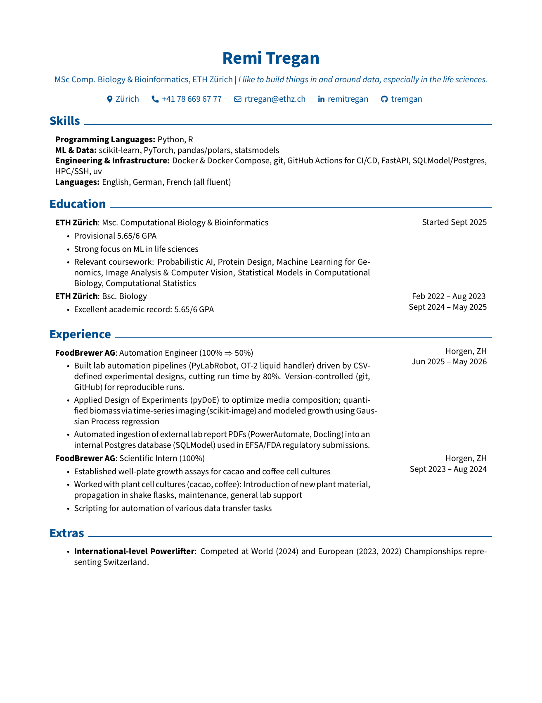

# cv

My CV. `cv.tex` is the source, `cv.pdf` is the output — don't edit the PDF,
it gets regenerated.

[](cv.pdf)

## Build

```bash
./watch.sh         # rebuilds cv.pdf on every save (what you normally want)
tectonic cv.tex    # one-off
```

Needs `tectonic` and `watchexec`:

```bash
brew install tectonic watchexec
```

Claude Code starts the watcher automatically (`.claude/settings.json`).

`preview.png` above is page 1 of `cv.pdf`, rendered by `./render-preview.sh`
(macOS `qlmanage`). The watcher regenerates it after every build, and the
pre-push hook refuses a push where it has gone stale.

`CLAUDE.md` has the rest — what this CV is aiming at, and the LaTeX quirks
worth knowing (en-dashes don't render, use `--`).
